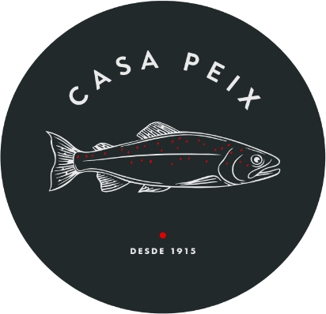

<div align="center">
  <br>
  
  <h1>Socios Peix</h1>


<h3>Web application to manage members of a specific hotel in Spain</h3>

</div>

## Project layout

| Folder | What |
|---|---|
| [`backend/`](./backend) | Rust (axum) API. See its [README](./backend/README.md) for the architecture and configuration. |
| [`frontend/`](./frontend) | Vue 3 single-page app, served by nginx which also proxies `/api` to the backend. |


## Deployment

The app runs as three containers: PostgreSQL, the backend and the frontend.
Images are built and pushed to GHCR by the **Publish Docker images** workflow
(run it manually from the Actions tab; give it a release tag such as `v0.3.0`
to also draft a GitHub release).

On the server:

```bash
cp .env.example .env      # fill in DB credentials, JWT_SECRET, email keys...
docker compose pull
docker compose up -d
```

The app is then served on `HTTP_PORT` (default 8080). Put your HTTPS reverse
proxy in front of it and set `COOKIE_SECURE=true`.

## Development

```bash
# backend (needs a local PostgreSQL; see backend/.env.example)
cd backend && cargo run

# frontend
cd frontend && pnpm install && pnpm dev
```

## About me

Check out my [other projects](https://github.com/mariinkys)

You can also help do this and more projects, [Buy me a Coffee](https://www.buymeacoffee.com/mariinkys)

## Copyright and Licensing

Copyright 2026 © Alex Marín

Released under the terms of the [GPL-3.0](./LICENSE)
